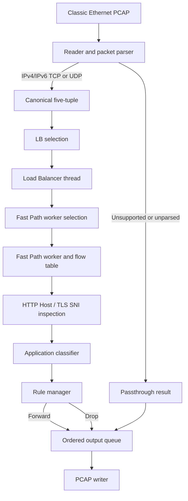

# C++ Deep Packet Inspection (DPI) Engine

A learning-oriented C++17 project that reads classic PCAP captures, parses Ethernet/IPv4/IPv6 TCP and UDP traffic, identifies some application domains from HTTP Host and TLS SNI, applies filtering rules, and writes a filtered PCAP. The Stage 10 version adds a bounded multithreaded processing pipeline with load balancers and fast-path workers.

> **Project scope:** This is an offline PCAP analyzer and filter. It does not capture live traffic, decrypt HTTPS, or block traffic on a live network interface.

**Documentation:** See [PROJECT_DOCUMENTATION.md](PROJECT_DOCUMENTATION.md) for the detailed architecture, packet formats, module responsibilities, thread/queue lifecycle, build commands, CLI options, test results, limitations, and troubleshooting. A formatted Word version is also provided as `PROJECT_DOCUMENTATION.docx`.

## Features

- Classic PCAP v2.4 reader and writer for Ethernet link-layer captures.
- Ethernet II parsing and up to four stacked 802.1Q/802.1ad VLAN tags.
- IPv4 and IPv6 parsing for TCP and UDP.
- Common IPv6 extension-header traversal (Hop-by-Hop, Routing, Destination Options, Fragment header for atomic fragments, and AH).
- Five-tuple flow identity with canonicalization so both directions of a connection are routed to the same worker.
- HTTP `Host` and TLS ClientHello SNI extraction when the required bytes are present in one captured TCP payload.
- Domain-based application classification for YouTube, Google, Facebook, Instagram, Netflix, GitHub, WhatsApp, and Discord.
- IPv4 source-address, application, and domain/subdomain blocking rules.
- Bounded producer/consumer queues, load-balancer threads, per-flow fast-path workers, and a single ordered PCAP writer.
- Output packet ordering restored to the original input capture order.
- Module, IPv6, and load-balancing tests.

## Architecture



For `--lbs 2 --fps 2`, the program creates two load-balancer threads and four fast-path workers (two workers owned by each load balancer). The reader/parser and output writer are additional threads.

## Repository layout

```text
Dpi engine/
├── include/
│   ├── app_classifier.h
│   ├── connection_tracker.h
│   ├── fast_path.h
│   ├── load_balancer.h
│   ├── packet_parser.h
│   ├── pcap_reader.h
│   ├── pcap_writer.h
│   ├── pipeline_stats.h
│   ├── pipeline_types.h
│   ├── rule_manager.h
│   ├── sni_extractor.h
│   ├── thread_safe_queue.h
│   └── types.h
├── src/
│   ├── DPI_engine.cpp       # Earlier single-threaded engine
│   ├── dpi_mt.cpp           # Stage 10 multithreaded executable
│   ├── main.cpp             # Packet parser diagnostic executable
│   ├── app_classifier.cpp
│   ├── connection_tracker.cpp
│   ├── fast_path.cpp
│   ├── load_balancer.cpp
│   ├── packet_parser.cpp
│   ├── pcap_reader.cpp
│   ├── pcap_writer.cpp
│   ├── rule_manager.cpp
│   └── sni_extractor.cpp
├── tests/
│   ├── test_dpi_modules.cpp
│   ├── test_ipv6_parser.cpp
│   └── test_load_balancing.cpp
├── captures/                # Put input .pcap files here
├── output/                  # Filtered PCAP files are written here
└── build/                   # Executables are written here
```


## Requirements

- C++17 compiler (MinGW-w64 GCC on Windows, or GCC/Clang on Linux/macOS).
- Standard C++ library with thread support.
- Classic PCAP input with Ethernet link type.
- No external packet-capture library is required for offline PCAP processing.

## Build on Windows (PowerShell + MinGW-w64)

Run these commands from the project root. The source archive does not require CMake.

```powershell
New-Item -ItemType Directory -Force build, captures, output | Out-Null

g++ -std=c++17 -Wall -Wextra -Wpedantic -O2 -pthread -I include `
    src/dpi_mt.cpp `
    src/fast_path.cpp `
    src/load_balancer.cpp `
    src/pcap_reader.cpp `
    src/pcap_writer.cpp `
    src/packet_parser.cpp `
    src/sni_extractor.cpp `
    src/app_classifier.cpp `
    src/rule_manager.cpp `
    src/connection_tracker.cpp `
    -o build/dpi_mt.exe
```

## Run the engine

Copy a classic `.pcap` file into `captures/`, then run:

```powershell
.\build\dpi_mt.exe `
    .\captures\input.pcap `
    .\output\filtered.pcap `
    --block-domain facebook.com `
    --lbs 2 `
    --fps 2
```

The input and output paths must be different. Create the `output` directory before running if it does not exist.

### Command-line options

| Option | Meaning | Default / accepted values |
|---|---|---|
| `--block-domain DOMAIN` | Block an exact hostname and its subdomains | Repeatable; e.g. `facebook.com` |
| `--block-ip IPV4` | Block packets whose source address matches this IPv4 address | Repeatable; IPv4 dotted decimal only |
| `--block-app APP` | Block a classified application | `YouTube`, `Google`, `Facebook`, `Instagram`, `Netflix`, `GitHub`, `WhatsApp`, `Discord`, `HTTP`, `HTTPS`, `DNS` (lowercase forms also accepted) |
| `--lbs N` | Number of load-balancer threads | 1–64; default 2 |
| `--fps N` | Fast-path workers per load balancer | 1–128; default 2 |
| `--queue-capacity N` | Capacity of each bounded pipeline queue | 1–1,000,000; default 2048 |

Total fast-path workers = `--lbs × --fps`. For example, `--lbs 4 --fps 2` creates 8 fast-path workers.

### More examples

Block an application:

```powershell
.\build\dpi_mt.exe .\captures\input.pcap .\output\no_youtube.pcap --block-app YouTube
```

Block several domains:

```powershell
.\build\dpi_mt.exe .\captures\input.pcap .\output\filtered.pcap `
    --block-domain facebook.com `
    --block-domain youtube.com
```

Tune worker and queue counts:

```powershell
.\build\dpi_mt.exe .\captures\large.pcap .\output\filtered_large.pcap `
    --lbs 4 --fps 4 --queue-capacity 4096
```

## Build and run tests

Run each test suite from the project root.

### 1. HTTP/TLS extraction and application classification

```powershell
g++ -std=c++17 -Wall -Wextra -Wpedantic -O2 -I include `
    tests/test_dpi_modules.cpp `
    src/sni_extractor.cpp `
    src/app_classifier.cpp `
    -o build/test_dpi_modules.exe

.\build\test_dpi_modules.exe
```

### 2. IPv6 parsing, canonical flow key, and domain rules

```powershell
g++ -std=c++17 -Wall -Wextra -Wpedantic -O2 -I include `
    tests/test_ipv6_parser.cpp `
    src/packet_parser.cpp `
    src/connection_tracker.cpp `
    src/rule_manager.cpp `
    src/app_classifier.cpp `
    -o build/test_ipv6_parser.exe

.\build\test_ipv6_parser.exe
```

### 3. Load-balancing and queue behavior

```powershell
g++ -std=c++17 -Wall -Wextra -Wpedantic -O2 -pthread -I include `
    tests/test_load_balancing.cpp `
    -o build/test_load_balancing.exe

.\build\test_load_balancing.exe
```

## How it works

1. `PcapReader` reads the classic PCAP global header and per-packet records.
2. `PacketParser` parses Ethernet/VLAN and IPv4/IPv6 TCP/UDP fields.
3. The reader builds a five-tuple and canonicalizes it so both directions share a flow key.
4. A first hash selects one load balancer.
5. The selected LB uses a separately mixed hash to select one of its fast-path workers.
6. The FP updates its private flow table, inspects eligible payloads, classifies the application, and evaluates rules.
7. Every processed input packet produces a result record. Dropped records are marked not-forwarded so the writer can advance its ordering index without writing their bytes.
8. The single writer buffers out-of-order worker completions by packet index and writes forwarded/passthrough packets in the original capture order.

